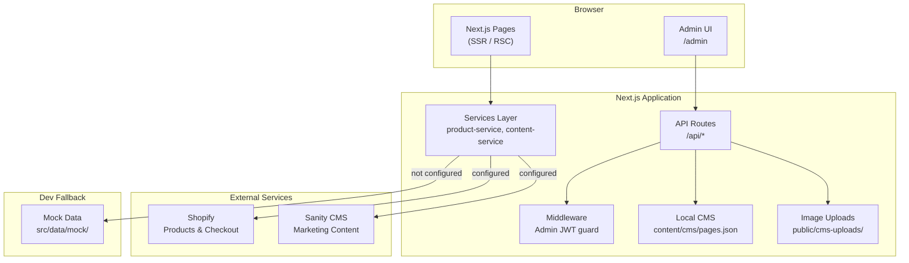

# Ceyloe Web — Architecture & Setup Guide

Luxury gemstone ecommerce website for **Ceyloe**. Custom-branded storefront built with Next.js, with product data from Shopify and marketing content from Sanity CMS (with local fallbacks for development).

---

## Table of Contents

1. [Overview](#overview)
2. [Tech Stack](#tech-stack)
3. [System Architecture](#system-architecture)
4. [Project Structure](#project-structure)
5. [Data Sources](#data-sources)
6. [Authentication](#authentication)
7. [Pages & Routes](#pages--routes)
8. [API Routes](#api-routes)
9. [Key User Flows](#key-user-flows)
10. [Environment Variables](#environment-variables)
11. [Getting Started](#getting-started)
12. [Connecting External Services](#connecting-external-services)
13. [Admin Panel](#admin-panel)
14. [Images & Assets](#images--assets)
15. [Deployment](#deployment)
16. [Current Limitations & Next Steps](#current-limitations--next-steps)

---

## Overview

Ceyloe Web is a **headless ecommerce** site:

- **Frontend:** Custom Next.js website (design, pages, UX)
- **Commerce backend:** Shopify (products, prices, inventory, checkout)
- **Marketing CMS:** Sanity (hero, testimonials, certifications) + local JSON admin
- **Development fallback:** Mock data when Shopify/Sanity are not configured

The site works **out of the box** without API keys using mock product and content data.

---

## Tech Stack

| Layer | Technology |
|---|---|
| Framework | Next.js 16 (App Router) |
| Language | TypeScript |
| UI | React 19, Tailwind CSS 4 |
| Animation | Framer Motion |
| Icons | Lucide React |
| Commerce API | Shopify Storefront API |
| CMS | Sanity (`@sanity/client`, `next-sanity`) |
| Admin auth | Password + JWT (`jose`) |
| Customer auth | Shopify Customer Account OAuth |
| Image processing | Sharp (build script for hero WebPs) |
| Hosting (recommended) | Vercel |

---

## System Architecture



### Data flow (catalog example)

```
User visits /catalog
    → Catalog page (Server Component)
    → product-service.getProducts()
    → Shopify API (if configured) OR mockProducts
    → Filters applied (category, color, price, carat, etc.)
    → ProductGrid rendered
```

### BFF pattern

API routes under `/api/*` act as a **Backend-for-Frontend** layer — the browser never talks to Shopify/Sanity directly with secrets.

---

## Project Structure

```
ceyloe-web/
├── public/
│   ├── images/
│   │   ├── hero/          # Responsive hero WebP slides
│   │   ├── stitch/        # Homepage section images
│   │   └── journal/       # Blog/journal images
│   └── cms-uploads/       # Admin-uploaded images
├── content/
│   └── cms/
│       └── pages.json     # Local CMS page storage
├── sanity/
│   └── schemas/           # Sanity document schemas
├── scripts/
│   └── generate-hero-webp.mjs
├── src/
│   ├── app/               # Next.js App Router (pages + API)
│   │   ├── api/           # BFF API routes
│   │   ├── admin/         # Admin dashboard
│   │   ├── catalog/       # Gemstone catalog
│   │   ├── products/      # Product detail pages
│   │   └── ...
│   ├── components/        # UI by feature (home, catalog, admin, etc.)
│   ├── config/            # Site config, env helpers, navigation
│   ├── contexts/          # React contexts (currency)
│   ├── data/              # Static content, mock data, hero slides
│   ├── lib/               # Shopify, Sanity, CMS, admin auth clients
│   ├── services/          # Business logic (abstracts data sources)
│   └── types/             # Shared TypeScript types
└── package.json
```

---

## Data Sources

### 1. Shopify (products — production)

| Item | Detail |
|---|---|
| Purpose | Product catalog, prices, images, inventory, checkout |
| Used by | `/catalog`, `/products/[handle]`, `/api/products` |
| Config | `NEXT_PUBLIC_SHOPIFY_STORE_DOMAIN`, `SHOPIFY_STOREFRONT_ACCESS_TOKEN` |
| Gemstone fields | Metafields: `carat`, `color`, `clarity`, `cut`, `origin`, `treatment`, `certification` |

**No traditional database** — Shopify is the product database.

### 2. Sanity CMS (marketing content)

| Item | Detail |
|---|---|
| Purpose | Hero, brand story, testimonials, certifications |
| Used by | `content-service` → homepage sections |
| Config | `NEXT_PUBLIC_SANITY_PROJECT_ID`, `SANITY_API_READ_TOKEN` |
| Schemas | `siteSettings`, `testimonial`, `certification` |

### 3. Mock data (development fallback)

| Item | Detail |
|---|---|
| Location | `src/data/mock/products.ts`, `src/data/mock/content.ts` |
| When used | Shopify or Sanity credentials not set |
| Purpose | Local dev without external accounts |

### 4. Local JSON CMS (custom pages)

| Item | Detail |
|---|---|
| Storage | `content/cms/pages.json` |
| Images | `public/cms-uploads/` |
| Purpose | Dynamic pages at `/p/[slug]` |
| Managed via | `/admin` dashboard |

### 5. Static content files

Blog posts, FAQ, about copy, hero slides, portfolio — in `src/data/`.

---

## Authentication

### Admin (`/admin`)

| Item | Detail |
|---|---|
| Method | Single shared password |
| Env var | `ADMIN_PASSWORD` |
| Session | JWT in HTTP-only cookie (`ceyloe-admin-session`) |
| Library | `jose` (HS256, 7-day expiry) |
| Guard | `src/middleware.ts` protects `/admin/*` and `/api/admin/*` |
| Capabilities | Manage CMS pages, upload images |

**Not a full user system** — no roles, emails, or user database.

### Customer (`/account`)

| Item | Detail |
|---|---|
| Method | Shopify Customer Account OAuth |
| Env var | `SHOPIFY_CUSTOMER_CLIENT_ID` |
| Routes | `/api/auth/shopify/login`, `callback`, `logout` |
| Purpose | Customer login, profile, orders (via Shopify) |

---

## Pages & Routes

### Public storefront

| Route | Purpose |
|---|---|
| `/` | Homepage (hero slideshow, collections, featured, bespoke, founder, journal) |
| `/catalog` | Gemstone & jewellery catalog with filters |
| `/products/[handle]` | Product detail page |
| `/compare` | Compare gemstones side-by-side |
| `/recommend` | Gemstone recommendation tool |
| `/about` | Brand story |
| `/heritage` | Mining heritage |
| `/certifications` | Trust & certification |
| `/transparency` | Sourcing transparency |
| `/portfolio` | Portfolio showcase |
| `/journal` | Blog listing |
| `/journal/[slug]` | Blog article |
| `/contact` | Contact form |
| `/book` | Book appointment |
| `/custom-jewelry` | Custom jewellery inquiry |
| `/wholesale` | Wholesale inquiry |
| `/faq` | FAQ |
| `/reviews` | Facebook reviews |
| `/account` | Customer account (Shopify) |
| `/p/[slug]` | Dynamic CMS pages |

### Admin

| Route | Purpose |
|---|---|
| `/admin/login` | Admin sign-in |
| `/admin` | Dashboard (page list) |
| `/admin/pages/new` | Create page |
| `/admin/pages/[id]` | Edit page |

---

## API Routes

| Endpoint | Method | Auth | Purpose |
|---|---|---|---|
| `/api/products` | GET | Public | Product list |
| `/api/recommend` | POST | Public | Gemstone recommendations |
| `/api/contact` | POST | Public | Contact form |
| `/api/inquiries/appointment` | POST | Public | Appointment booking |
| `/api/inquiries/custom-jewelry` | POST | Public | Custom jewellery inquiry |
| `/api/inquiries/wholesale` | POST | Public | Wholesale inquiry |
| `/api/currency/rates` | GET | Public | Currency exchange rates |
| `/api/admin/login` | POST | Public | Admin login |
| `/api/admin/logout` | POST | Admin | Admin logout |
| `/api/admin/pages` | GET, POST | Admin | List/create CMS pages |
| `/api/admin/pages/[id]` | GET, PUT, DELETE | Admin | CRUD single page |
| `/api/admin/upload` | POST | Admin | Image upload (max 5MB) |
| `/api/auth/shopify/login` | GET | Public | Shopify OAuth start |
| `/api/auth/shopify/callback` | GET | Public | Shopify OAuth callback |
| `/api/auth/shopify/logout` | POST | Public | Customer logout |

---

## Key User Flows

### Browse catalog

1. User opens `/catalog`
2. Server fetches products via `product-service`
3. Filters applied from URL query params
4. `ProductGrid` + `CatalogFilters` rendered
5. User can compare gems or open product detail

### Add CMS page (admin)

1. Admin logs in at `/admin/login`
2. Creates page at `/admin/pages/new`
3. Adds sections (hero, text, image, text+image)
4. Uploads images via `/api/admin/upload`
5. Publishes → page live at `/p/[slug]`

### Customer purchase (when Shopify connected)

1. User browses `/catalog` (data from Shopify)
2. Opens product → `/products/[handle]`
3. Checkout handled by Shopify
4. Optional: customer login at `/account` via Shopify OAuth

---

## Environment Variables

```env
# Site
NEXT_PUBLIC_SITE_URL=https://ceyloe.com

# Admin
ADMIN_PASSWORD=your-secure-password

# Shopify Storefront API
NEXT_PUBLIC_SHOPIFY_STORE_DOMAIN=your-store.myshopify.com
SHOPIFY_STOREFRONT_ACCESS_TOKEN=shpat_...
SHOPIFY_API_VERSION=2024-10

# Shopify Customer Auth (optional)
SHOPIFY_CUSTOMER_CLIENT_ID=

# Sanity CMS (optional)
NEXT_PUBLIC_SANITY_PROJECT_ID=
NEXT_PUBLIC_SANITY_DATASET=production
NEXT_PUBLIC_SANITY_API_VERSION=2024-01-01
SANITY_API_READ_TOKEN=

# Hero video (optional)
NEXT_PUBLIC_HERO_VIDEO_URL=
NEXT_PUBLIC_HERO_POSTER_URL=
```

---

## Getting Started

### Prerequisites

- Node.js 20+
- npm

### Steps

```bash
# 1. Clone and enter project
cd ceyloe-web

# 2. Install dependencies
npm install

# 3. Create environment file
cp .env.example .env.local   # if .env.example exists; otherwise create .env.local manually

# 4. Set admin password (minimum for admin panel)
# Add ADMIN_PASSWORD=your-password to .env.local

# 5. Start development server
npm run dev

# 6. Open in browser
# http://localhost:3000
```

### Other scripts

```bash
npm run build          # Production build
npm run start          # Start production server
npm run lint           # ESLint
npm run generate:hero  # Generate responsive hero WebP images from public/images/Home/
```

---

## Connecting External Services

### Shopify (catalog products)

1. Create a Shopify store
2. In Shopify Admin → Settings → Apps → develop apps → create Storefront API access token
3. Add credentials to `.env.local`
4. Add product metafields for gemstone specs (`carat`, `color`, `clarity`, `cut`, `origin`, `treatment`, `certification`)
5. Add products in Shopify Admin — they appear on `/catalog` automatically

**Recommended plan:** Shopify Basic (~$39/month)

### Sanity (marketing content)

1. Create project at [sanity.io](https://sanity.io)
2. Add project ID and token to `.env.local`
3. Schemas defined in `sanity/schemas/index.ts`
4. Content replaces mock data when configured

---

## Admin Panel

**URL:** `/admin`  
**Login:** Single password (`ADMIN_PASSWORD`)

### What admin can do today

- Create/edit/delete **CMS pages**
- Upload **images** (stored in `public/cms-uploads/`)
- Build pages with sections: hero, text, image, text+image
- Publish pages at `/p/[slug]`

### What admin cannot do today

- **Add/edit catalog products** (gems, prices, specs)
- Product management is via **Shopify Admin** (or not built yet for custom DB)

---

## Images & Assets

### Hero slideshow (homepage)

| Asset | Location | Recommended size |
|---|---|---|
| Main hero slides | `public/images/hero/slide-*-{desktop,tablet,mobile}.webp` | Desktop: 1920×900, Tablet: 1200×700, Mobile: 800×1200 |
| Stitch hero image | `public/images/stitch/hero-jewelry.png` | 1920×900 landscape |
| Slide config | `src/data/stitch-hero-slides.ts` | 4 slides, 6s interval |

Generate hero WebPs from source JPGs:

```bash
# Place source images in public/images/Home/1.jpg … 7.jpg
npm run generate:hero
```

### CMS uploads

- Path: `public/cms-uploads/`
- Max size: 5MB
- Types: images only

---

## Deployment

### Recommended: Vercel

1. Push repo to GitHub
2. Import project in Vercel
3. Set environment variables
4. Deploy

### Notes

- Local JSON CMS (`content/cms/pages.json`) and `cms-uploads/` are **filesystem-based** — on serverless hosting, admin uploads may not persist across deploys unless using persistent storage or an external CMS/DB
- For production admin CMS, consider moving to Sanity or a database
- Shopify and Sanity are cloud-hosted and work well with Vercel

---

## Current Limitations & Next Steps

| Area | Status | Recommendation |
|---|---|---|
| Product admin in `/admin` | Not built | Use Shopify Admin, or build product CRUD + DB |
| Traditional database | None | Add PostgreSQL/Supabase if custom product admin needed |
| CMS persistence on Vercel | File-based | Move to Sanity or DB for production |
| Customer checkout | Via Shopify | Connect Shopify when ready to sell |
| Multi-user admin | Single password | Add proper auth (NextAuth, Clerk) if needed |

### Suggested roadmap

1. **Phase 1:** Launch with mock data + custom design (current state)
2. **Phase 2:** Connect Shopify for real products and checkout
3. **Phase 3:** Connect Sanity for editable marketing content
4. **Phase 4:** Build product admin OR train staff on Shopify Admin
5. **Phase 5:** Production deploy on Vercel with domain

---

## Design System

| Token | Value |
|---|---|
| Primary background | Deep black `#0A0A0A` |
| Accent | Luxury gold `#C9A227` |
| Heading font | Libre Caslon Text |
| Body font | Manrope |
| Breakpoint | Mobile-first from 360px |

---

## Support & Contacts (site config)

Configured in `src/config/site.ts`:

- Phone: 0449 938 172
- WhatsApp: +61 449 938 172
- Head office: Kalgoorlie WA, Australia
- Mining office: Minuwangoda, Sri Lanka
- Instagram: @ceyloegemstones
- Facebook: Ceyloe Gemstone

---

*Last updated: June 2026*
